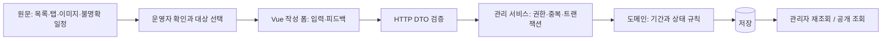

# 외부 채용 공고 13개 실제 등록 점검

> **개선 구현 완료 기록:** 사용자 승인 이후 [등록 개선·실제 시간 전환 검증](improvements-20261013.md)을 수행했다. 아래는 구현 전의 역사적 기록이다.

> **2026-10-13 후속 결과:** 사용자가 알려 준 당시 공고명과 다른 게시처·공식 PDF로 [11개 공고를 재점검](source-recovery-20261013.md)했다. 미확인 5개의 모집 안내를 복원했고 KB 대상 부문·쎄트렉아이 식별·IBK 기술 미확인 판정을 수정했다. 아래는 10월 12일 당시의 기록이며 최신 판단은 후속 보고서를 따른다.

점검일은 2026-10-12다. 사용자 결정에 따라 결과를 먼저 보고 구현 범위를 정한다. **제품 코드는 변경하지 않았다.** DEMP의 로컬 관리자 등록을 점검했으며 기업 채용 사이트에 지원서를 제출하지 않았다.

결과는 **조건부 초안 저장·재조회 3건, 입력 제약으로 저장 불가 5건, 제공 URL에서 원래 공고를 확인할 수 없는 5건**이다. 저장된 3건도 정확한 공개 자료로 완성된 것은 아니다. 원문 일정 충돌, 대표 직무만 선택, 날짜 시각의 임의 정규화, 원본 이미지 제외가 남아 있다.

## 환경과 보이는 실행

| 항목 | 확인 값 |
| --- | --- |
| 백엔드 기준 | `1de07e79555d2029e1f368e83df29eba9dca8726` |
| 프런트 기준 | `d9a71aae0f174a348973f4360833c61026a7e5f7` |
| 각 저장소 브랜치 | `refactor/real-posting-registration` |
| worktree 상위 경로 | `/Users/seungmin/Desktop/repo/archive/demp/.worktrees/real-posting-registration` |
| 앱 | `http://127.0.0.1:5059`, Vite → Spring `18089` |
| DB | 별도 H2 메모리 DB `demp_registration_20261012` |
| 호출 workspace / surface | `workspace:1000030002` / `surface:1000030004` |
| 오른쪽 보조 pane | `pane:1000030011` |
| 서버 / 점검 러너 터미널 | `surface:1000030019` / `surface:1000030025` |
| 앱 / 원문 브라우저 | `surface:1000030023` / `surface:1000030024` |
| 점검 로그 확인 터미널 | `surface:1000030026` |

`CMUX_WORKSPACE_ID`와 `cmux identify --json`으로 호출 workspace를 확인했다. `CMUX_SURFACE_ID`가 없어 caller 정보의 surface를 사용했다. 현재 시각적 포커스는 다른 workspace였으므로 작업 대상으로 삼지 않았다. 호출 터미널 오른쪽에 보조 pane 하나를 만들고 그 안의 surface를 재사용했다. 사용자 입력 터미널에 명령을 보내지 않았다.

서버·러너 명령은 `cmux send --workspace workspace:1000030002 --surface …`로 실행했다. 실제 브라우저 탐색·클릭·입력·선택·달력 선택·파일 선택·새로고침은 `cmux browser --surface …`로 수행했다. 해당 CLI의 브라우저 조작 명령에는 workspace 옵션이 없으므로, 같은 workspace에 생성한 고유 surface를 지정했다. `eval`은 화면 값 읽기에 사용했고 앱 저장을 우회하지 않았다. Playwright mock E2E나 headless 결과를 보이는 검증으로 대신하지 않았다.

로컬 seed 회원에 관리자 역할을 추가하는 별도 SQL을 이 H2 인스턴스에만 적용했다. 운영 DB·S3에는 접근하지 않았다. 저장 확인은 브라우저 새로고침과 별도 인증 요청으로 확인한 트랜잭션 이후 조회다. **메모리 DB이므로 서버 재시작 후의 보존을 검증한 것은 아니다.** 서버와 보조 pane은 결과 확인을 위해 유지했다.

## 수행 순서와 집계 기준

1. 원문 13개를 새로 수집하고 실제 브라우저로 열었다. 목록 URL은 상세 후보를 구분했고, 만료된 번호를 다른 공고로 대체하지 않았다. 초기 수집의 마지막 3건은 요청 제한으로 실패하여 재시도했다.
2. 13개를 각각 새 작성 화면에 입력하고 저장을 눌렀다. 미확인 기술·일정·분야를 비워 두었으므로 첫 시도는 모두 저장되지 않았다. **이 사실을 13개 기능 결함으로 해석하지 않는다.** 이 시도에서는 입력 보존 13/13을 확인했다.
3. 원문에서 날짜·직무를 더 확인하고 보완 입력했다. 일자만 있는 항목에는 현재 달력의 `00:00` 기본값을 사용한 검증용 정규화임을 본문에 적었다. 제품 기술을 추측해서 채우지 않았다. SK·넥슨은 저장됐고, KT·우리·KB·IBK는 기술만 비어 있는 상태에서 저장이 막혔다.
4. 슈어소프트테크는 사용자가 지정한 풀스택 행을 확인하고 직접 저장했다. 원본 이미지 첨부가 거절되어 텍스트만 저장됐고, 시작·마감 시각이 모두 `00:00`이 됐다.
5. 저장된 3건을 새 인증 요청으로 재조회하고 공개 목록에 나타나지 않음을 확인했다. 넥슨 서버 직무로 분리 등록을 시도하여 중복 충돌과 입력 보존도 확인했다.
6. 하나·다우·LG 두 번호·Future Ship URL은 별도로 다시 열어 원문 식별 불가 상태를 확인했다. 초기에 로딩 중 수집된 화면보다 재확인 자료를 우선한다.

아래 결과의 “초안 저장”은 기술적으로 저장과 조회가 됐다는 뜻이다. 세 건 모두 `DRAFT`, 출처 확인 일시 `null`이며 공개 목록에는 seed 공고만 남았다. 원문을 완전히 옮겼거나 게시 준비가 됐다는 뜻으로 사용하지 않는다.

## 13개 개별 결과

| 번호 / 원문 | 실제 확인과 입력 | 최종 점검 결과 | 부족한 점과 개선 방향 |
| --- | --- | --- | --- |
| 1. [SK R261841](https://www.skcareers.com/Recruit/Detail/R261841) | SKT Junior Talent, SW·AI Model. 화면 상단은 9/11~9/17 13시, 본문은 8/24~8/30 16:59:59로 충돌. 대표 분야 BACKEND와 상단 일정을 검증용으로 선택. | **초안 ID 2 저장·재조회**. 일정 충돌과 시작 00시 정규화 메모를 남김. | 하나의 분야만 선택 가능. 상충하는 원문 값을 확인 대기로 보존하고, 같은 공고의 여러 직무를 표현할 필요. |
| 2. [하나금융TI 264146](https://hanati.recruiter.co.kr/app/jobnotice/view?jobnoticeSn=264146&systemKindCode=MRS2) | 요청 번호는 채용 목록으로 이동. 목록에 있는 다른 번호의 AI Agent 경력 공고와 동일하다고 판단하지 않음. | **원문 미확인**. 제목·분야·기간을 확정하지 못한 채 저장 제약 확인. | 만료·이동 상태와 원래 식별자를 남기고 재확인 가능해야 함. 다른 공고로 자동 치환하면 안 됨. |
| 3. [넥토리얼](https://nexon-tutorial.com/) | 게임 클라이언트·서버·엔진을 한 공고로 모집. 채용형 인턴십 6개월. 8/25~9/7 16시; 시작 시각 미기재. GAME_CLIENT를 대표로 선택. | **초안 ID 3 저장·재조회**. GAME_SERVER로 같은 원문을 별도 등록하면 중복 거절. | 여러 분야 표현 필요. 기존 공고 바로가기 없는 중복 오류로 복귀 비용 발생. 시작 일자와 시각의 정밀도 구분 필요. |
| 4. [KT 263897](https://recruit.kt.com/careers/263897) | NW 인프라운용·B2B·B2C 등 모집. 8/25 10시~9/7 16시. NW 하위 직무에 SYSTEM_NETWORK 선택. Cloud·Data 같은 일반 용어를 특정 제품 태그로 바꾸지 않음. | **기술 스택 필수로 저장 불가**. 다른 필수 입력을 채운 뒤에도 같은 오류. | 기술 제품을 명시하지 않는 실제 공고를 정확하게 저장할 수 있어야 함. 이미지 본문과 여러 직무의 구분 필요. |
| 5. [우리은행](https://jrs.jobkorea.co.kr/wooribank) | 기본 탭 대신 TECH를 클릭. IT개발·정보보호 확인. 8/27~9/8 14시. SQL은 코딩시험 과목이므로 업무 스택에서 제외. | **기술 스택 필수로 저장 불가**. 입력 유지. | 시험 과목을 업무 기술로 오인하지 않도록 필수·우대·시험의 의미를 구분. 탭별 직무를 공고에 연결할 필요. |
| 6. [KB국민은행](https://kbstar.careerlink.kr/) | 홈의 채용공고 클릭 후 7개 목록에서 [IT 상세](https://kbstar.careerlink.kr/jobs/RC20260828033775) 선택. AI·플랫폼개발과 별도 공고. 8/31~9/9 18시. | **기술 스택 필수로 저장 불가**. 입력 유지. | 자동 추출 0개를 공고 없음으로 단정하면 안 됨. 홈 URL·개별 상세 식별과 이미지 본문 확인 필요. 자격증 우대를 업무 스택으로 강제하지 않아야 함. |
| 7. [다우기술](https://recruit.daou.co.kr/recruit) | 개별 공고가 아닌 목록. 실제 화면에 총 0개 표시. | **원문 미확인**. 특정 제목·분야·일정을 추측하지 않음. | 채용 목록과 단일 공고를 구분하고, 공고 없음·확인 대기 상태 보존 필요. |
| 8. [LG 1002085](https://careers.lg.com/apply/detail?id=1002085) | `/apply`로 이동, 존재하지 않거나 조회 기간이 지난 공고 안내. | **원문 미확인**. 제목·계열사·직무 확정 불가. | 원래 번호와 만료 상태를 보존. 현재 목록의 다른 공고를 이 번호의 내용으로 쓰지 않아야 함. |
| 9. [IBK기업은행](https://ibk.incruit.com/index_main_2025.asp) | 여러 채용 종류 중 [신입행원 상세 projectid=128](https://ibk.incruit.com/hire/viewhire.asp?projectid=128) 선택. 디지털·IT 구분, 8/28~9/14 10시. IT 대표 분야로 APPLICATION_PROGRAM 선택. | **기술 스택 필수로 저장 불가**. 입력 유지. | 메인에서 대상 상세 선택을 명확히 하고 기술 미명시를 허용할 필요. 직무기술서 등 추가 자료와 분야 연결 필요. |
| 10. [LG 1002127](https://careers.lg.com/apply/detail?id=1002127) | 별도 원문 번호도 `/apply`로 이동하고 같은 만료 안내. | **원문 미확인**. 8번과 독립적으로 점검. | 두 번호를 합치거나 현재 공고로 치환하지 않고 각 원문의 상태 추적 필요. |
| 11. [Future Ship URL](https://sifuture-ship.careerlink.kr/) | 화면은 `쎄트렉아이(마페용)`, 페이지 제목도 쎄트렉아이 채용으로 표시. 요청한 모집 본문·일정은 확인 불가. | **원문 미확인**. 초안 입력에 사용한 임시 기관명은 확인된 사실이 아니며 저장하지 않음. | 제공 URL과 실제 표시 기관의 불일치를 알려야 함. 신세계 또는 특정 교육·채용이라고 추정하여 확정하지 않아야 함. |
| 12. [당근 Backend 전환형 인턴](https://careers.daangn.com/jobs/role/8007747003/) | 커뮤니티 아파트팀, Kotlin·Java·Spring, 마감 10/18 23:59와 조기 마감 가능. 시작일 미기재. | **시작일 필수로 저장 불가**. 분야·기술·마감을 입력해도 시작일이 필요. | 미기재와 상시 모집을 구분할 필요. 정확한 마감과 조기 종료 가능 조건을 함께 표현할 필요. |
| 13. [슈어소프트테크 풀스택](https://careers.suresofttech.com/job_posting/wVNIw92d) | 연구소 SW개발 이미지 표의 풀스택 행 선택. React·TS·Spring Boot·Python 등 확인. 10/1~10/20, 시각 없음. | **초안 ID 1 저장·재조회**. 8.4MiB 원본 이미지 거절, 텍스트만 저장. 마감 `10/20 00:00`. | 읽을 수 있는 이미지 용량 조정·오류 회복 필요. 날짜만 있는 마감의 의미 보존, 필수와 우대 기술 구분 필요. |

기간 표기는 원문을 확인한 결과이며 현재 접수 가능성을 보증하지 않는다. 이미 지난 기간도 과거 공고 등록 시나리오로 점검했다. KB·IBK는 제공 URL에 여러 후보가 있으므로 위 표의 상세를 선택한 결과만 보장한다.

## 실제 재현한 공통 문제와 책임 경계

**미확인 값과 초안 완성도가 섞여 있다.** 폼은 `DRAFT`도 분야·기술·시작·마감을 요구한다. KT·우리·KB·IBK의 기술 오류와 당근 시작일 오류는 실제 화면에서 재현했다. 원문 미확인 5건도 중간 확인 상태로 저장하지 못한다. 이 5건은 먼저 원문의 문제이며, DEMP가 원래 내용을 복원할 수 있다고 주장하지 않는다.

서버 `AnnouncementFields`도 분야와 두 날짜에 `@NotNull`, 기술에 `@NotEmpty`를 요구한다. `RecruitPeriod` 생성자는 양쪽 날짜가 없으면 거절한다. 이는 코드에서 확인한 서버 경계이며, 이번에 빈 값을 서버로 강제 전송해 재현한 결과는 아니다. 프런트만 완화하면 완결된 해결이 되지 않는 이유다. 게시 가능성 판단의 소유자와 불완전한 상태의 저장 계약을 함께 정해야 한다.

**일자만 있는 정보를 정확한 시각처럼 저장한다.** 실제 달력에서 슈어소프트테크 10/1·10/20을 골랐더니 두 값이 모두 `00:00`으로 저장됐다. 서버 재조회도 `2026-10-20T00:00:00`이었다. 원문이 마감 시각을 밝히지 않았으므로 이 값을 정확한 마감 시각으로 볼 근거가 없다. 달력 `selectDate`의 기존 시각 또는 `00:00` 기본값과 분 단위 입력 계약이 원인이다. 무조건 23:59로 바꾸는 것도 원문 사실을 새로 만드는 것이므로 날짜 정밀도를 보존하는 계약이 필요하다.

**여러 직무를 담을 자리가 하나다.** 분야가 단일 값이므로 SK SW·AI와 넥슨 클라이언트·서버·엔진을 함께 표현하지 못한다. 넥슨을 GAME_SERVER로 추가 저장하면 409에 대응하는 안내가 표시됐고 입력은 유지됐다. 중복 키는 정규화 원문 URL·기관·기수이며 제목·직무를 포함하지 않는다. 중복 보호 자체는 동작한다. 한 공고의 여러 직무를 표현하는 모델과, 충돌 응답에서 기존 공고로 이동하는 계약을 검토해야 한다.

**이미지 오류는 안내되지만 저장 결과와 연결되지 않는다.** 원본 JPEG는 8,832,637바이트이고 5MiB 제한을 넘었다. `5MB 이하의 JPEG 또는 PNG 이미지를 선택해 주세요.`가 표시되고 편집기 이미지 수는 0개였다. 이후 텍스트 초안 저장은 가능했다. 오류가 조용히 사라졌다고 주장하지 않는다. 운영자가 원본을 포함하려던 작업을 같은 화면에서 회복할 수 있는지, 읽을 수 있는 축소·압축·분할·미리보기 또는 첨부 제외의 명시적 선택을 어떻게 제공할지 정해야 한다. 용량 제한만 없애면 서버의 합계 제한과 읽기 성능 문제가 남는다.

**기술의 의미가 한 목록으로 합쳐진다.** 슈어소프트테크의 필수·우대 기술이 같은 태그 배열에 들어갔다. 우리은행 SQL은 시험 과목이어서 보완 입력에서는 제외했다. 초기 시도 자료에는 SQL이 포함돼 있으나 이를 최종 업무 스택 근거로 사용하지 않는다. 원문에 기술이 없을 때 가짜 태그를 추가하면 저장은 되더라도 검색 결과의 의미가 훼손된다.

## 유지해야 할 기존 동작

- 13개 첫 시도에서 제목·기관·원문·본문 입력을 유지했다. 보완 입력의 기술 오류와 넥슨 중복 오류에서도 확인했다.
- FULLSTACK, GAME_CLIENT/GAME_SERVER, 채용형 인턴십과 필요한 주요 기술 선택지가 이미 있었다. 분류를 전부 새로 만들 필요는 없다.
- 중복 등록을 거절했고 기존 레코드 수는 3건으로 유지됐다.
- 초안 3건은 공개 목록에 나타나지 않았다. 출처 확인 처리도 임의로 완료하지 않았다.

## 검증 명령·실제 결과·한계

| 검증 | 실제 결과 | 근거 |
| --- | --- | --- |
| Java 25 `./gradlew test bootJar --console=plain` | exit 0, 63 suite / 417 tests, failures·errors·skipped 0, bootJar 성공 | [백엔드 로그](../../../.firecrawl/registration-audit-20261012/backend-baseline.log), worktree `build/test-results/test` |
| Node 24 `npm ci --offline --ignore-scripts`, `npm test` | 설치 exit 0, 테스트 exit 0, 53 files / 320 tests 통과 | [설치 로그](../../../.firecrawl/registration-audit-20261012/frontend-install.log), [프런트 로그](../../../.firecrawl/registration-audit-20261012/frontend-baseline.log) |
| `baseline_browser.py` | exit 0, 13개 독립 시도, 입력 보존 13/13 | [결과 JSON](baseline-results.json), [로그](../../../.firecrawl/registration-audit-20261012/baseline-browser.log) |
| `operator_browser.py` | exit 0, SK·넥슨 저장 후 각 8개 값 재확인, 4개 기술 필수 오류 확인 | [결과 JSON](operator-results.json), [로그](../../../.firecrawl/registration-audit-20261012/operator-browser.log) |
| `additional_audit.py` | 최종 exit 0, 별도 API·이미지·중복 총 14 assertions 통과 | [로그](../../../.firecrawl/registration-audit-20261012/additional-audit.log), [서버 재조회](fresh-api-requery.json) |
| `recheck_sources.py` | exit 0, 원문 미확인 5개 별도 재확인 | [결과](../../../.firecrawl/registration-audit-20261012/source-rechecks.json) |

추가 점검 스크립트는 처음에 상세 응답에 없는 `id`를 읽어 `KeyError`로 exit 1이었다. 실제 응답을 확인하고 목록에서 받은 ID를 진단 메타데이터 `auditId`로 붙이도록 고친 뒤 재실행했다. [최초 실패 로그](../../../.firecrawl/registration-audit-20261012/additional-audit.log.first-failure)를 보존한다. 이는 점검 스크립트 오류이며 제품 기능 Red로 기록하지 않는다.

기존 테스트 통과는 변경 전 기준 확인이다. 13개 실제 원문을 완전하게 수용한다는 보증이나 새로운 회귀 테스트의 Green이 아니다. 이번 단계에서는 제품 변경이 없어 전체 `scripts/verify.sh`, 프런트 lint·build, 서버 재시작, 공개 전환·수정·삭제·네트워크 장애 회복을 새로 검증하지 않았다. 로컬 fixture 관리자 검증이므로 운영 계정·배포 환경 검증으로 확대하지 않는다.

## 화면·명령 근거

원본 수집 파일, 실제 브라우저 명령별 종료 코드·출력, 13개 폼/원문 스크린샷, 실행 스크립트를 worktree의 [로컬 근거 폴더](../../../.firecrawl/registration-audit-20261012)에 보존했다. `.firecrawl`은 Git 제외 경로다. 아래 JSON과 이 문서는 미커밋 변경으로 남긴다. 이미지·전체 외부 원문을 커밋 대상으로 추가하지 않았다.

- [13개 첫 입력 결과](baseline-results.json), [보완 입력 결과](operator-results.json), [별도 서버 조회](fresh-api-requery.json), [최종 분류](results.json).
- [실제 브라우저 입력 명령](../../../.firecrawl/registration-audit-20261012/baseline-browser-commands.log), [보완 명령](../../../.firecrawl/registration-audit-20261012/operator-browser-commands.log), [추가 검증 명령](../../../.firecrawl/registration-audit-20261012/additional-browser-commands.log).
- [SK 저장 화면](../../../.firecrawl/registration-audit-20261012/01-sk-saved.png), [넥슨 저장 화면](../../../.firecrawl/registration-audit-20261012/03-nexon-saved.png), [KT 기술 필수 오류](../../../.firecrawl/registration-audit-20261012/04-kt-technology-required.png), [당근 시작일 오류](../../../.firecrawl/registration-audit-20261012/12-daangn-form.png).
- [슈어소프트 이미지 거절](../../../.firecrawl/registration-audit-20261012/suresoft-image-rejection.png), [해당 이미지 행 확인](../../../.firecrawl/registration-audit-20261012/suresoft-roles-inspection.png), [넥슨 두 번째 직무 충돌](../../../.firecrawl/registration-audit-20261012/nexon-second-position-conflict.png).
- [LG 1002085 재확인](../../../.firecrawl/registration-audit-20261012/08-lg-1002085-source-rechecked.png), [LG 1002127 재확인](../../../.firecrawl/registration-audit-20261012/10-lg-1002127-source-rechecked.png), [Future Ship 실제 표시](../../../.firecrawl/registration-audit-20261012/11-shinsegae-visible-rechecked.png).

## 범위를 고르기 위한 제안

| 후보 | 사용자가 얻는 결과 | 구현 전 확정할 계약 |
| --- | --- | --- |
| A. 미확인 정보 보존과 일정 정확도 — 우선 권장 | 알려진 정보만으로 초안 보관, 다음 확인 작업 이어가기. 기술 미명시·시작일 미기재·일자만 있는 마감을 사실대로 표시. | 초안 최소 정보, 공개 필수 정보, 미확인과 해당 없음·상시 모집의 차이, 날짜 정밀도와 기존 데이터 호환. 공개에서도 원문에 없는 기술을 강제할지는 별도 판단. |
| B. 여러 직무와 기술 의미 | 한 원문 아래 SW·AI 또는 클라이언트·서버를 구분해 검색·표시. 필수·우대·시험 과목 구분. | 공고와 직무의 소유 관계, 분야 검색·API 호환, 중복 키 유지, 충돌한 기존 공고 바로가기. |
| C. 이미지 입력 회복 | 긴 원본을 읽을 수 있게 첨부하고 저장 전 결과 확인. 실패한 첨부를 다시 처리하거나 제외한 의도 확인. | 압축·축소·분할 정책, 합계 제한, 본문과 첨부 오류의 상태 소유자, 가독성 기준. |
| D. 원문 식별·확인 대기 | 목록·탭에서 선택한 상세와 최초 제공 URL을 함께 남김. 만료·기관 불일치·확인 대기를 추적. | 최초 URL·선택 상세·확인 일시, 원문 확인 실패 시 복귀, 다른 공고로 바뀌지 않는 검증. 자동 수집 도입 여부는 별도 범위. |

권장 순서는 A를 먼저 작은 사용자 경로로 끝내고 B·C를 선택하는 것이다. A만으로 원문 미확인 5개의 내용을 복구할 수는 없다. D의 상태 보존 또는 사용자의 정확한 원문 재확인이 필요하다. 범위 결정 뒤 테스트를 먼저 작성하고, 실제 실패 원인을 확인한 다음 구현한다.

이번 단계의 책임·이름 검토: 폼은 입력·피드백, HTTP DTO는 요청 계약, 관리 서비스는 권한·중복·저장 흐름, 기간 도메인은 기간의 불변식을 소유한다. 기존 `language`는 기술 목록까지 포함하는 공개 필드이므로 이번 진단에서 이름만 바꾸지 않았다. 변경 시 직렬화·기존 클라이언트·검색 계약을 함께 다룬다. Vue에는 props/event·상태·API 경계로 판단하고 SOLID 판정을 붙이지 않는다. 제품 코드와 TypeScript 모듈은 수정하지 않았다.
