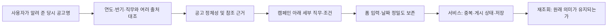

# 당시 공고명으로 원문을 복원한 재점검

> 이후 사용자 승인으로 [등록 개선과 모집 상태 전환 검증](improvements-20261013.md)을 수행했다. 아래는 구현 전 조사·재현 결과다.

2026-10-13, 사용자가 알려 준 정확한 기업·공고명 11개로 다시 조사했다. 링커리어·인크루트·캐치·잡코리아·비즈니스피플·인디스워크, 기업 공식 블로그와 대학 취업 게시판을 대조했다. **이전에 본문을 확인하지 못했던 5개 공고 모두 당시 모집 안내를 찾았다.** 다만 공고 전체의 모든 세부 직무 요건을 복구했다는 뜻은 아니다.

현재 cmux에서 11개를 다시 입력한 최종 결과는 **조건부 초안 저장·재조회 6개, 저장 제약 5개**다. 추가 중복 실험으로 하나 공고가 두 번 저장되어 실제 로컬 초안은 7건이다. 모두 공개 목록에서 제외됐다. 당근·슈어소프트테크는 이번에 새 공고명이 제공된 11개에 포함되지 않아 전날 결과를 유지했다.

제품 코드 수정·커밋·운영 게시 없이 조사와 재현 결과를 보완했다. 기존 보고서의 “원문 미확인 5개”와 IBK의 “기술 미확인으로 저장 불가”는 아래 결과로 갱신한다.

## 먼저 바로잡은 판정

- **KB국민은행:** 전날 선택한 IT 부문 대신 요청한 **AI·플랫폼개발** 공고로 다시 입력했다. 두 공고는 같은 모집 기간의 별도 부문이다.
- **LG:** 원문 번호 1002085는 사용자 식별에 따라 LG전자, 1002127은 LG CNS Cloud Application Modernization으로 대조했다. 다른 회사의 현재 공고를 대신 사용하지 않았다.
- **쎄트렉아이:** Future Ship을 신세계 계열 또는 교육 과정으로 추정하지 않는다. 하반기 포스터·대학 공지·대체 게시처가 일치했다. 상반기 검색 결과의 6주 인턴십은 하반기에 적용하지 않았다.
- **IBK:** 모집 안내만 보면 태그를 확정하기 어려웠지만, 공식 직무기술서 4쪽·6쪽에 **SQL 문법과 사용방법**이 필요지식으로 명시됐다. SQL을 넣고 저장·재조회했다. 이 사례의 앞선 차단은 자료 수집 미완료가 원인이었으므로 DEMP의 기술 필수 결함 사례에서 제외한다.
- **SK:** 공식 캠페인은 원문과 같은 R261841로 연결하며 8/24~8/30 일정을 안내한다. 이번에는 요청한 당시 SW개발을 기준으로 입력했다. 원문 상단의 9월 표기가 추가 접수인지 오래된 본문인지까지 확정하지 않았으며 출처 확인 완료로 표시하지 않았다.

## 기업별 근거와 실제 등록 결과

| 기업 / 당시 대상 | 복원·대조한 출처 | 확인한 내용 | 현재 폼에서의 최종 결과 |
| --- | --- | --- | --- |
| SK텔레콤 / Junior Talent Tech SW개발 | [공식 캠페인](https://skt-juniortalent.co.kr/), [당시 링커리어 공고](https://linkareer.com/activity/344860), 기존 R261841 본문 | SW개발은 BSS·백엔드·Infra·AI 플랫폼 등을 포함. 원문 하단은 8/30 16:59:59 마감. | **저장·재조회 ID 1**. 대표 BACKEND 선택. 초는 최초 서버 저장에서 보존됐지만 같은 날짜를 달력에서 재선택하면 59초가 없어지는 결함 재현. |
| 하나금융융합기술원 / 하반기 체험형인턴 | [링커리어 및 원본 포스터](https://linkareer.com/activity/345218), [인크루트](https://lab.incruit.com/jobs/2608250002755), [캐치](https://m.catch.co.kr/NCS/RecruitInfoDetails/567548) | AI-OCR, Python·PyTorch. 10월~다음 2월 약 5개월, 세전 월 230만 원·중식 지원. 계약 연장·정규직 전환 불가. | **저장·재조회 ID 2**, 이미지 1개 보존. 체험형 인턴 enum은 정상 지원. 월급·근무 기간·전환 불가는 본문에만 보존. 대체 URL 중복 실험에서 ID 6 추가 생성. |
| 넥슨컴퍼니 / For Game Programmer | [공식 페이지](https://nexon-tutorial.com/), [잡코리아](https://www.jobkorea.co.kr/Recruit/GI_Read/49843485), [이화여대 게시판](https://biz.ewha.ac.kr/biz/biz/notice.do?mode=view&articleNo=794613) | 법인·프로젝트를 나누지 않는 단일 모집. 클라이언트·서버·엔진, C++ 또는 C#. 12/7부터 6개월 채용형 인턴십. 법인에 따라 근무지 상이. | **저장·재조회 ID 3**. GAME_CLIENT만 대표 선택. 직무·법인·근무지·기간 관계와 기술의 “또는” 조건은 본문에 의존. |
| KT / 대졸신입 | [공식 상세](https://recruit.kt.com/careers/263897), [링커리어](https://linkareer.com/activity/345239) | NW 인프라운용·B2B·B2C 모집, 8/25 10시~9/7 16시. | **기술 필수로 저장 불가**. NW를 SYSTEM_NETWORK로 선택했지만 확인한 모집 안내에서 제품 기술을 확정하지 못함. Cloud라는 일반 용어를 AWS로 추측하지 않음. |
| 우리은행 / TECH | [링커리어 TECH 공고](https://linkareer.com/activity/346142), [당시 상세 경로](https://jrs.jobkorea.co.kr/wooribank/wooribank264/Agi/Invite), [인디스워크](https://inthiswork.com/archives/391708) | IT개발·정보보호 구분. SQL은 시험 과목이라는 근거만으로 업무 기술로 넣지 않음. | **기술 필수로 저장 불가**. 대표 IT개발 분야와 실제 마감을 넣고도 기술 선택 필요. |
| KB국민은행 / AI·플랫폼개발 | [링커리어](https://linkareer.com/activity/347031), [인크루트](https://lab.incruit.com/jobs/2609010001000), [고려대 공지](https://ie.korea.ac.kr/board/jobs/584) | 금융플랫폼·상담 채널·AI Agent·제휴 서비스·클라우드 풀스택 AI 플랫폼. AWS 자격증은 우대 항목. | **기술 필수로 저장 불가**. 대표 AI 분야 선택. 우대 자격증을 필수 제품 기술로 바꾸지 않음. 이전 IT 부문의 결과와 구분. |
| 다우기술 / 하반기 경력·신입 대규모 영입 | [링커리어](https://linkareer.com/activity/346946), [공식 8/31~9/10 직무 목록](https://blog.naver.com/daoustory/224389835245), [목록이 연결한 금융·증권 IT개발](https://blog.naver.com/daoustory/224036418684) | 경력·신입, 개발·엔지니어·영업·지원 직무가 함께 있음. 신입 금융·증권 IT개발 설명에 Java·C/C++·Python 등의 활용 명시. | **해당 신입 개발 직무로 저장·재조회 ID 4**. 전체 캠페인을 완전히 등록한 것으로 계산하지 않음. 직무별 경력·지역을 연결하기 어려움. |
| LG전자 / 하반기 신입 | [링커리어와 당시 화면 이미지](https://linkareer.com/activity/344996), [캐치](https://m.catch.co.kr/NCS/RecruitInfoDetails/567424), [고려대 게시판](https://gup.korea.ac.kr/bbs/cdc/526/271980/artclView.do) | 8/24 15시~9/13 23시. 여러 사업본부의 로봇·기계·전기전자·HR·영업 등. 일반 학사 이상과 특정 캠퍼스 석사 이상 조건이 다름. | **분야 미선택으로 저장 불가**. 포괄 공채 전체를 임의의 개발 직무로 바꾸지 않음. 개발 직무 선별 또는 공고-세부직무 관계의 운영 정책이 필요. |
| IBK기업은행 / 디지털·IT | [공식 블로그](https://blog.ibk.co.kr/569692), [링커리어](https://linkareer.com/activity/346537), [공식 직무기술서 PDF](https://raspfiles2.incruit.com/ibk/data/128/SuccessData/addFile/%EC%A7%81%EB%AC%B4%EA%B8%B0%EC%88%A0%EC%84%9CvF.pdf) | 디지털·IT의 상세 직무는 별도 PDF. 두 분야 모두 필요지식에 SQL 명시, 학력·전공 무관. | 첫 시도 차단 후 **PDF 근거로 SQL을 넣어 저장·재조회 ID 7**. 여러 분야와 외부 첨부의 연결 문제는 남음. |
| LG CNS / Cloud Application Modernization | [비즈니스피플의 해당 직무 상세](https://m.bzpp.co.kr/recruit/detail/BR260831A00228), [링커리어의 전체 모집](https://linkareer.com/activity/346611) | 필수 개발 경험·프로젝트 경험·협업, 조직 사용 기술과 AI·Cloud 우대를 구분 가능. 본사·프로젝트 현장, 1월 풀타임 가능 조건. | **저장·재조회 ID 5**. FULLSTACK을 대표 선택. 필수·우대·조직 사용 기술이 같은 태그 배열로 합쳐짐. 일자만 확인된 일정의 시각은 여전히 점검용 00시. |
| 쎄트렉아이 / 하반기 SI Future-Ship | [링커리어](https://linkareer.com/activity/346942), [경북대 포스터·공지](https://aicollege.knu.ac.kr/bbs/board.php?bo_table=sub6_3_b&wr_id=1851), [숭실대 공지](https://cse.ssu.ac.kr/bbs/board.php?bo_table=employment&wr_id=687), [인디스워크 보관 화면](https://inthiswork.com/archives/391357) | 학사 SW 임베디드·지상국·궤도역학·신뢰성 시험, 석박사 SW 비행제어. 하반기 절차는 인턴십 없이 신입 입사 후 3개월 수습. | **기술 필수로 저장 불가**. 임베디드를 대표 선택하되 포스터에 없는 C/C++를 추정하지 않음. 연결된 개별 공식 URL도 현재 세부 본문 미노출. |

### 복원 내용의 정확성 한계

원문과 동일한 제목·기업·연도·반기·역할 및 모집 일자를 대조했다. 검색 결과 첫 항목을 그대로 채택하지 않았다. 쎄트렉아이 최초 검색의 상반기 결과와 다우기술 5월 모집·1월 신입 모집은 제외했다. 다우의 2026년 8월 목록이 연결한 직무 소개는 2025년에 작성된 재사용 자료다. 현재 확인한 연결 내용이며 당시 버전까지 증명하지는 못한다.

하나의 포스터는 접수 일자만 표시하고 인크루트는 00:00·23:59를 표시한다. 다우 마감 시각은 게시처 간 차이가 있어 확정하지 않았다. 일자만 확인된 칸에 넣은 00:00은 현재 필수 시각 입력을 통과하기 위한 진단용 정규화이며 원문 사실이 아니다. 따라서 저장 성공 6건 모두 검증용 `DRAFT`이고 출처 확인 일시는 비어 있다.

쎄트렉아이는 [별도 공식 상세 URL](https://satreci.careerlink.kr/jobs/RC20260825033613)까지 찾았지만 현재 채용 사이트 공통 화면만 나온다. 모집 분야·공통 조건·절차는 포스터로 복원했고, 직무별 제품 기술까지 복원한 것으로 보고하지 않는다. KT·우리·KB 역시 확인한 자료에서 확정하지 못한 기술을 억지로 선택하지 않은 결과다. 향후 다른 세부 근거가 발견되면 IBK처럼 갱신해야 한다.

## 새로 재현한 결함과 기능 공백

### 1. 동일 공고의 대체 URL은 중복을 통과한다 — 실제 저장 재현

하나 공고의 회사·제목·직무·기간·본문·원문 식별값 `264146`을 같게 두었다.

```text
공식 URL로 처음 저장                         → ID 2
동일 공식 URL로 다시 저장                    → 중복 오류, 입력 유지
URL만 linkareer.com/activity/345218로 변경   → ID 6 추가 저장
```

원문 식별값이 같아도 서로 다른 레코드가 됐다. 현재 `AnnouncementSourceKey`는 URL·기관·기수로 키를 만들고 `sourceIdentifier`를 사용하지 않는다. 이는 단순 URL 변경 문제를 넘어, 원문이 만료되었을 때 보조 출처를 추가하는 운영 방식과 맞물린다. 같은 공고의 출처들을 연결할 공고 정체성과 여러 참조 URL의 관계가 필요하다. 자동으로 제목만 같다고 합치는 방식도 다른 회차를 잘못 합칠 수 있으므로 해결책으로 확정하지 않는다.

근거: [중복 비교 JSON](source-alias-summary-20261013.json), [실제 화면](../../../.firecrawl/registration-recheck-20261013/runtime/hana-alternative-source-result.png).

### 2. 같은 날짜를 달력에서 다시 선택해도 마감 초가 바뀐다 — 실제 수정 재현

SK 원문 하단의 `2026-08-30T16:59:59`를 입력했다. 최초 서버 저장에는 59초가 남았지만 폼은 `16:59`만 표시했다. 달력에서 **동일한 8월 30일**을 다시 골라 저장하자 서버 값이 `2026-08-30T16:59:00`이 됐다. 상세 응답에서 변경된 필드는 마감일 하나뿐이었다. 검증 후 같은 UI로 로컬 예제 값을 59초로 복원했으며 제품 결함은 수정하지 않았다.

원인은 날짜 입력 컴포넌트의 표시 `slice(0,16)`와 달력 선택 시 시각 추출 `slice(11,16)`이다. 기존의 “시·분 유지” 계약이 초 단위 원문을 보존하지 못한다. 기존 날짜만 있는 일정의 00시 문제와 함께, 원문 정밀도와 실제 저장값을 같은 계약으로 다뤄야 한다.

근거: [변경 필드 JSON](sk-seconds-loss-20261013.json), [최종 재현 로그](../../../.firecrawl/registration-recheck-20261013/runtime/precision-run.log), [값 복원 확인](../../../.firecrawl/registration-recheck-20261013/runtime/sk-fixture-restored.json).

### 3. 체험형 인턴은 선택할 수 있지만 월급·근무 기간은 본문에만 남는다 — 화면·저장 응답 확인

하나의 `EXPERIENTIAL_INTERNSHIP`, Python·PyTorch, 포스터 1개는 저장과 새로고침에서 보존됐다. 그러나 화면의 보상 필드는 **연봉**이며 월급 단위 선택이 없다. 모집 접수일과 별도로 5개월 근무 기간·월 230만 원·중식 지원·전환 불가 조건을 입력할 구조도 없다. 이번 저장에서는 이를 본문과 이미지에 보존했고 숫자 보상 값은 비워 뒀다. 잘못된 연봉으로 실제 저장했다고 주장하지 않는다.

이 정보가 본문에 있으면 열람은 가능하지만 조건 비교·필터·일관된 요약에 사용하기 어렵다. 금액과 지급 단위, 근무 기간, 전환 여부의 책임을 분리할 필요가 있다. 체험형·채용형 인턴 enum 자체는 이미 지원하므로 새 enum을 만드는 문제로 잘못 진단하지 않는다.

### 4. 캠페인·세부 직무·필수와 우대의 관계를 평평하게 만든다 — 폼·재조회 확인

분야는 단일 select, 기술은 단일 배열이다. LG CNS의 필수 개발 경험과 조직 사용 기술·우대 기술을 다른 성격으로 저장할 수 없다. 다우는 전체 신입·경력 캠페인에서 한 신입 개발 직무를 골라야 했고, 넥슨은 클라이언트·서버·엔진 중 대표 분야를 선택했다. 서로 다른 역할의 경력·지역·학력 조건은 본문에 의존한다.

LG전자의 분야 미선택 차단 자체는 정상 필수 검증이다. 문제는 비개발 직무도 포함하는 포괄 공채를 DEMP에서 어떻게 접수하고 개발 관련 직무를 선택할지 운영 흐름이 없다는 것이다. 모든 직무 분류를 무조건 추가해야 한다는 결론은 아니다.

### 5. 원문 미기재 또는 아직 확인하지 못한 기술에도 초안 저장이 막힌다 — 실제 입력 재현

KT·우리·KB AI·쎄트렉아이 네 사례에서 분야·본문·출처·모집일을 채우고 기술을 비워 두면 `기술 스택을 하나 이상 선택해 주세요.`로 저장이 막혔다. 입력은 유지됐지만 확인 중인 초안을 서버에 보관하지 못한다. “원문에 미기재”와 “추가 자료 확인 중”은 다르게 기록할 수 있어야 한다. 공개 기준을 낮추거나 가짜 기술을 선택하는 우회는 해결로 보지 않는다.

IBK는 PDF에서 SQL을 찾은 뒤 정상 저장됐으므로 위 네 사례에 포함하지 않는다. 외부 직무기술서·이미지·본문을 확인하는 과정 자체도 출처 근거에 연결할 필요가 있다. 현재 본문에는 PDF 링크를 넣을 수 있지만 구조화된 참조 자료 목록·확인 범위가 없다.

## 책임과 데이터 흐름



현재 중복 규칙 소유자는 [`AnnouncementSourceKey`](../../../src/main/java/com/inhatc/demp/domain/announcement/AnnouncementSourceKey.java)다. 화면에만 중복 판단을 추가하면 API 경로가 달라질 때 같은 문제가 재발한다. 날짜 표시·선택은 [`RecruitmentDateTimeField`](../../../../frontend/src/components/announcement/RecruitmentDateTimeField.vue), 보상 입력은 [`CompensationFields`](../../../../frontend/src/components/announcement/CompensationFields.vue)가 맡는다. API와 도메인의 기간·금액 계약도 함께 검토해야 한다.

이번 진단에서 객체·필드 이름은 바꾸지 않았다. `language`가 언어뿐 아니라 기술을 포함한다는 기존 공개 계약, `sourceIdentifier`와 실제 중복 키가 분리된 책임을 기록했다. Vue는 props/event·표현·상태 경계로 평가했으며 컴포넌트에 SOLID 판정을 붙이지 않았다.

## 실제 실행과 검증 범위

- 코드 기준은 이전과 같은 백엔드 `1de07e7`, 프런트 `d9a71aa`, 각 `refactor/real-posting-registration` worktree다.
- 현재 호출 정보는 `workspace:1000050001`, `surface:1000050001`이다. 기존 임시 pane·서버가 없어 호출 터미널 오른쪽에 보조 `pane:1000050007`을 만들었다. 서버는 `surface:1000050008`, 앱은 `1000050009`, 원문은 `1000050010`, 러너는 `1000050011`이다. 명령과 실제 클릭·입력 과정을 이 workspace에 표시했다.
- 기존 `/private/tmp` 실행 파일이 정리돼 첫 서버 시작 명령은 파일 없음으로 실행되지 않았다. 보존된 스크립트에서 새 임시 폴더와 별도 H2 `demp_registration_20261013`을 구성하여 시작했다. 전날 메모리 DB의 레코드를 이어 쓴 것이 아니다.
- 준비 명령 `./gradlew test bootJar --console=plain`은 exit 0이지만 8개 task가 `UP-TO-DATE`였다. 전날의 백엔드 417개 테스트를 이번에 새로 실행했다고 보고하지 않는다. 프런트 `npm test`는 이번에 53 files / 320 tests가 실제 통과했다.
- `recheck_browser.py`: exit 0. 11개 입력, 당시 5개 저장·6개 차단, 같은 URL 중복 거절과 다른 URL 중복 생성 관찰. 모든 차단에서 입력 보존 검증.
- `ibk_pdf_check.py`: exit 0. PDF 확인 후 SQL로 재시도하여 저장·재조회. 최종 공고별 결과는 6개 저장·5개 차단으로 갱신.
- `precision_check.py`: 최종 exit 0. 같은 날짜 선택 시 초 손실, 변경 필드 1개, 예제 값 복원 확인. 첫 실행은 저장 직후 assertion에서 실패했고 원시 비교값을 기록하지 못했다. 별도 재조회 후 저장값 대기를 명시하여 재현했으며 [최초 실패 로그](../../../.firecrawl/registration-recheck-20261013/runtime/precision-run.log.first-failure)도 보존했다. 제품 TDD의 Red/Green으로 부르지 않는다.
- 최종 `verify_report.py`는 exit 0. 11개 결과 집계, 초안 7건·공개 노출 0건, 중복 출처 2건, SK 예제 값 복원, IBK SQL, 하나 이미지, 문서 링크와 제품 변경 0건을 확인했다. [최종 검증 결과](../../../.firecrawl/registration-recheck-20261013/runtime/final-verification.json)를 보존했다.
- 실제 Spring/H2에 저장한 초안 7건을 별도 인증 API로 조회했고, 공개 목록에는 seed 공고만 있었다. 프로세스 재시작 후 보존·운영 DB·운영 게시·새 전체 CI 검증까지 수행한 것은 아니다.

원본 검색 JSON·추출 문서·공고 이미지·PDF는 [로컬 출처 폴더](../../../.firecrawl/registration-recheck-20261013/sources), 실행 스크립트·명령별 결과·화면은 [로컬 실행 근거](../../../.firecrawl/registration-recheck-20261013/runtime)에 보존했다. 이 경로는 Git 제외 대상이다. [최종 결과 JSON](source-recovery-results-20261013.json)과 본 보고서는 미커밋 문서 변경으로 남긴다.

## 이번 근거로 제안하는 우선순위

1. **원문 의미가 달라지는 문제:** 날짜 재선택의 초 손실, 일자만 있는 값의 시각 처리, 대체 출처의 동일 공고 중복을 우선한다.
2. **확인 작업을 이어갈 수 있는 초안:** 미기재·미확인 상태와 출처 자료를 보존하되 게시 기준과 분리한다.
3. **실제 조건 비교:** 여러 직무와 각 직무의 조건, 기술의 필수·우대·조직 사용 구분, 월급·근무 기간을 확장한다.

원문을 찾지 못한 상태에서 추정했던 문제와, 원문 복원 후에도 실제 재현된 문제를 구분했다. 구현 범위는 아직 확정하지 않았으며 기능 변경은 하지 않았다.
